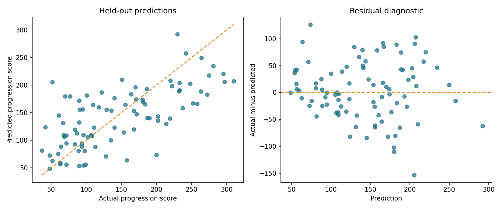

# Diabetes Progression: Ridge Regression Benchmark

[](LICENSE)


Build and diagnose a regularized regression baseline for a quantitative progression score.

شرح مختصر بالمصري في [EXPLAIN_AR.md](EXPLAIN_AR.md).

## Dataset, questions and method

**Data:** the real scikit-learn diabetes regression dataset, 442 samples, ten features. Source: https://scikit-learn.org/stable/modules/generated/sklearn.datasets.load_diabetes.html . Loader uses `scaled=False`; all scaling is learned only within training folds. Dataset description and the original Efron et al. reference are retained in `data/dataset_description.txt`.

**Method:** 80/20 train/test split (seed 42); Pipeline(StandardScaler, Ridge); five-fold shuffled training CV selects alpha from 0.1, 1, 10, 100 and 1000 by MAE. Compare held-out MAE/RMSE/R-squared against a training-mean DummyRegressor. Inspect actual-versus-predicted and residual plots. Hyperparameters are not chosen using the test result.

**Not a medical tool:** the target is a quantitative progression measure one year after baseline, not a diagnostic label or calibrated clinical risk. Feature meanings in the original source have caveats; do not infer treatment decisions. Historical small benchmark only, no clinical deployment claims.

## Setup

Tested with Python 3.10.12. Use Python 3.10 or 3.11 and a fresh virtual environment.
Run the following **inside this project folder**:

```bash
python -m venv .venv
# Windows PowerShell:
.venv\Scripts\Activate.ps1
# macOS / Linux:
source .venv/bin/activate
python -m pip install -r requirements.txt
python main.py
```

Choose only the activation command for your operating system. If PowerShell blocks activation,
you can use `.venv\Scripts\python.exe` instead of `python` for each command.
All input data is included or comes bundled with scikit-learn; running requires no account,
API key, paid service or dataset download. Installing dependencies needs an internet connection.
The pinned requirements record the tested direct dependencies, not every transitive dependency.
All paths are relative to the script, so main.py also works when launched elsewhere.

## Repository map

- `main.py`: commented, reproducible analysis/training pipeline.
- `data/`: original data or dataset description and attribution.
- `outputs/`: actual generated reports, metrics, charts and run log.
- `EXPLAIN_AR.md`: short Egyptian-Arabic walkthrough and interview prompts.
- `requirements.txt`: tested direct package versions.

Results below are from the included reproducible run, not invented targets.

## Predict numeric scores

```bash
python predict.py --input outputs/sample_input.csv
```

CSV needs ten original raw feature columns as listed in the dataset description. The sample contains five held-out feature rows. Output is a progression-score estimate, not medical advice. Do not use this on real patients. Only load trusted joblib files. Saved pipeline is fitted on training rows only and matches the reported evaluation.

## Reproduced results

### Diabetes regression results

- 353 training samples; 89 untouched test samples.
- Chosen alpha: 1.0; 5-fold training CV MAE: 45.00.
- Test MAE: 42.81; RMSE: 53.78; R-squared: 0.454.
- Mean-only baseline MAE: 64.01; RMSE: 73.22; R-squared: -0.012.

Target is the dataset's quantitative progression measure one year after baseline,
not a diabetes diagnosis, a probability or a treatment recommendation. MAE and RMSE are
in target-score units. This small historical benchmark cannot establish clinical validity.
Features are raw loader values, standardized only inside training folds. Hyperparameter
selection uses training CV; no test-driven tuning. Saved pipeline matches this evaluation.
Residual structure and error magnitude show why this is only a simple learning baseline.


## Tests and next steps

The downloadable five-project review bundle contains the integration test suite. This standalone repository can be verified with `python main.py` and its saved report. To rerun only this project: `python main.py`.

Before presenting this as your own work, understand each cleaning choice, explain every metric, and add a change you can defend. This is a ready-to-study portfolio starter, not a claim of client work or original data collection.

## Bundled data and reports

Real datasets and generated reports are compressed in the root `11-project-assets.zip` file.
`resources.py` verifies its SHA-256 and extracts it automatically the first time you run
`main.py` or the dashboard. No web request is made. A numeric prefix on the archive filename
is harmless and supported. You can also run `python resources.py` explicitly before browsing
the output images locally. Saved joblib models are not published; run main.py to train them.
The full data-source notes and original notices remain inside the archive.

## Project preview


